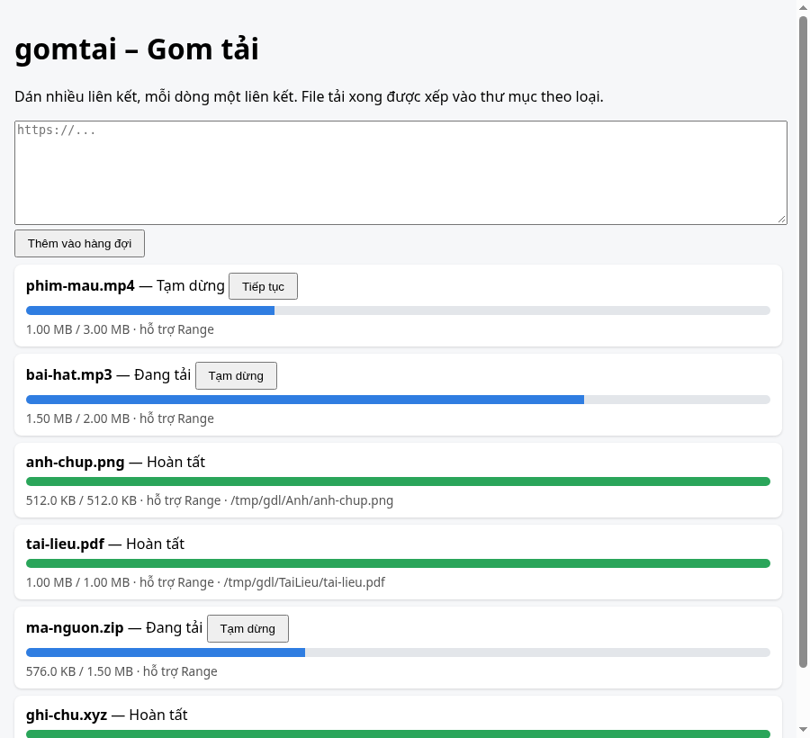

# gomtai – Gom tải

Trình quản lý tải file nhỏ gọn viết bằng Python: dán nhiều liên kết, file được tải song song qua hàng đợi, mỗi file có thanh tiến độ riêng, có thể tạm dừng/tiếp tục, và tải xong thì tự xếp vào thư mục theo loại. Có cả dòng lệnh (CLI) lẫn giao diện web nhỏ.



## Tính năng

- Hàng đợi với số luồng tải song song cấu hình được (`-w`, mặc định 3).
- Tạm dừng / tiếp tục từng file. Khi tiếp tục, gomtai gửi header `Range` để tải nối phần còn lại; nếu máy chủ không trả về `206 Partial Content` thì tải lại từ đầu.
- Thanh tiến độ riêng cho từng file (trên web và trong terminal).
- Tự xếp file đã xong vào thư mục: `Video`, `Nhac`, `Anh`, `TaiLieu`, `NenCo`, `ChuongTrinh`, `Khac` (theo phần mở rộng). Trùng tên thì thêm hậu tố ` (1)`, ` (2)`…
- Demo chạy hoàn toàn offline với máy chủ HTTP cục bộ phục vụ file mẫu.

## Giới hạn (nói rõ để không hứa quá)

- Mỗi file tải bằng **một** kết nối; chưa chia nhỏ file thành nhiều đoạn song song.
- Chỉ hỗ trợ `http`/`https`. Không hỗ trợ torrent, FTP, trang cần đăng nhập, hay trích video từ trang web.
- Trạng thái hàng đợi nằm trong bộ nhớ; tắt chương trình là mất danh sách (file `.partial` vẫn còn nhưng chưa tự nạp lại).
- Phân loại dựa trên phần mở rộng trong URL, không đọc nội dung file.
- Giao diện web không có xác thực; mặc định chỉ lắng nghe trên `127.0.0.1`. Đừng mở ra mạng ngoài.

## Tôn trọng máy chủ

gomtai **không** vượt qua bất kỳ cơ chế chặn hay bảo vệ nào: không giải captcha, không lách paywall hay DRM, không giả mạo trình duyệt. Mọi lỗi HTTP (403, 404, 429, …) được ghi nhận là lỗi và dừng lại. Chỉ tải những gì bạn có quyền tải.

## Cài đặt (dùng venv)

```bash
git clone https://github.com/vietphan98/gomtai.git
cd gomtai
python3 -m venv .venv
source .venv/bin/activate        # Windows: .venv\Scripts\activate
pip install -e '.[dev]'
```

Yêu cầu Python 3.9 trở lên (đã chạy thử trên Python 3.13).

## Sử dụng

```bash
# Dòng lệnh: tải các liên kết, lưu vào thư mục downloads/
gomtai get https://example.com/a.pdf https://example.com/b.zip -d downloads
gomtai get -f links.txt -w 4

# Giao diện web
gomtai web -d downloads          # mở http://127.0.0.1:8800
```

## Demo offline

Terminal 1 – chạy máy chủ mẫu (có độ trễ nhỏ để thấy thanh tiến độ chạy):

```bash
python demo/server.py --port 8765 --delay 0.05
```

Terminal 2:

```bash
gomtai get -f demo/links.txt -d /tmp/gomtai-demo
# hoặc
gomtai web -d /tmp/gomtai-demo   # rồi dán nội dung demo/links.txt vào ô liên kết
```

Máy chủ mẫu còn có `/norange/<tên file>` (không hỗ trợ Range) và `/forbidden` (trả về 403) để thử các trường hợp đặc biệt.

## Kiểm thử

```bash
pytest -q
```

Các test dùng máy chủ mẫu ở cổng ngẫu nhiên, kiểm tra: tải song song và nội dung đúng từng byte, xếp thư mục, tạm dừng/tiếp tục bằng Range, tải lại khi máy chủ không hỗ trợ Range, lỗi 403/404, từ chối URL không phải http/https, trùng tên, và API web.

## Thư viện bên thứ ba

| Thư viện | Dùng cho | Giấy phép |
|---|---|---|
| [Flask](https://flask.palletsprojects.com/) (kèm Werkzeug, Jinja2, Click, ItsDangerous, MarkupSafe, Blinker) | Giao diện web | BSD-3-Clause (Blinker: MIT) |
| [pytest](https://pytest.org/) | Kiểm thử (chỉ khi phát triển) | MIT |

Phần tải file chỉ dùng thư viện chuẩn của Python (`urllib`, `threading`, `queue`).

## Giấy phép

MIT © 2026 Việt Phan. Xem [LICENSE](LICENSE).
